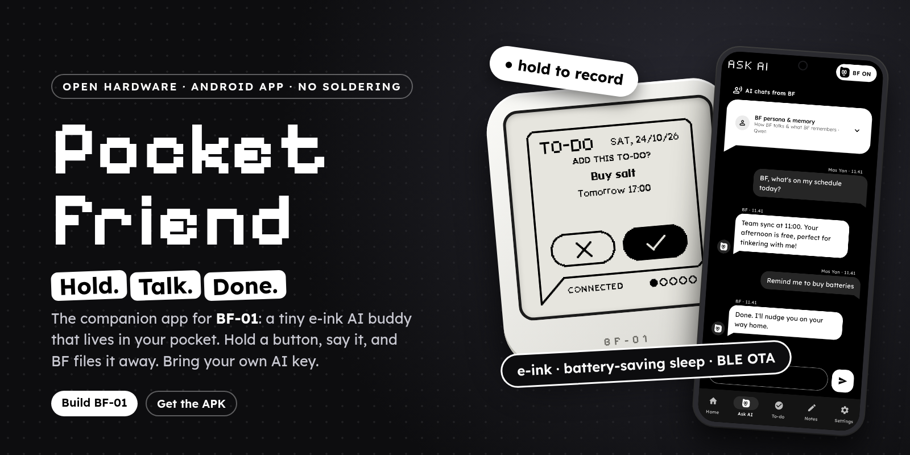
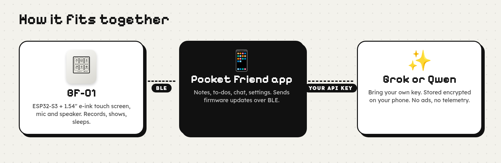
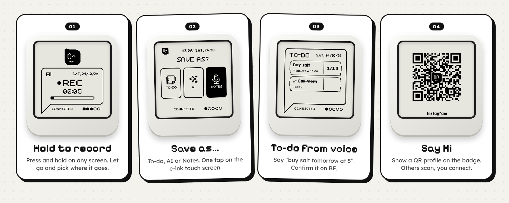
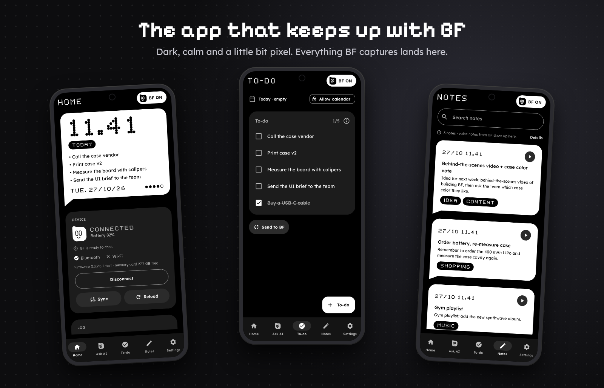
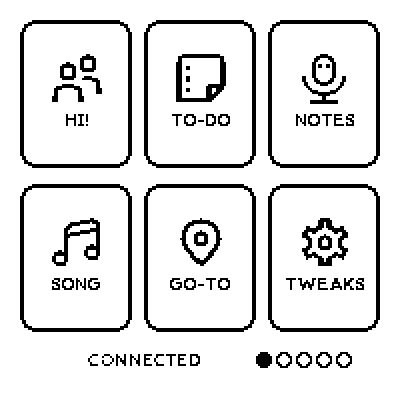
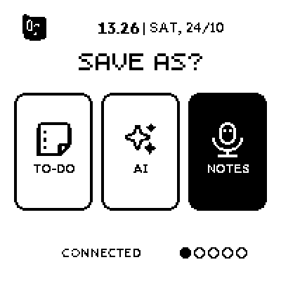
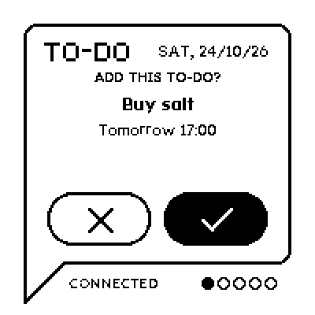

<p align="center">
  
</p>

<p align="center">
  <a href="https://github.com/yanuarm00/pocket-friend/releases/latest"></a>
  
  
  
</p>

<h3 align="center">Hold. Talk. Done.</h3>

<p align="center">
  <a href="https://github.com/yanuarm00/pocket-friend/releases/latest/download/PocketFriend.apk"><b>⬇ Get the APK</b></a> ·
  <a href="#-build-your-own-bf-01">Build a BF-01</a> ·
  <a href="#-roadmap">Roadmap</a> ·
  <a href="#-join-in">Join in</a>
</p>

---

## 🐣 What is BF-01?

BF-01 is a little e-ink friend that fits in your hand. It has a small face, a speech-bubble screen, a touch panel and a microphone. There is no feed to scroll and nothing glows at you.

You press and hold, you say something, and BF-01 files it: a to-do, a note, or a question for your AI. Pocket Friend is the Android app that goes with it. It keeps your notes, your tasks and your chats, and it updates BF-01 over Bluetooth.

It started as a hobby project: *what if an AI companion was calm, pocket-sized and a bit cute?* Now we are looking for other makers to build one and help make it better.

<p align="center">
  
</p>

## ✨ Highlights

<p align="center">
  
</p>

| | |
|---|---|
| 🎙️ **Hold to record, anywhere** | Press and hold the button on *any* screen. Let go and choose *Save as…* To-do, AI or Notes. |
| 💬 **AI chat blocks** | Ask BF-01 a question and the answer shows up as a bubble on the e-ink screen. The whole conversation is in the app. Bring your own Grok (xAI) or Qwen key. |
| ✅ **To-do from voice** | Say "buy salt tomorrow at five". BF-01 shows *Add this to-do?* and you confirm with one tap. Tasks sync with the app. |
| 👋 **Say Hi QR profiles** | Show a QR code of your profile (Instagram, for example) on the screen. Friends scan it, no typing needed. |
| 🔋 **E-ink + battery saving** | The screen only draws when something changes. BF-01 sleeps with quiet hours and wakes when you touch it. |
| 📡 **BLE OTA updates** | The app downloads the firmware, checks its SHA-256 against an official list and sends it over Bluetooth. If the new firmware fails to boot, BF-01 rolls back by itself. |
| 📍 **Where's mine?** | Ring BF-01 or see where it was last connected on a map. |

## 📱 The app

<p align="center">
  
</p>

Home shows the same bubble as BF-01 and the battery level. Ask AI, To-do and Notes mirror what happens on the device. Voice notes you record on BF-01 show up in Notes when the phone connects.

## 🖼️ A peek at the BF-01 screen

<p align="center">
  
  
  
</p>
<p align="center"><sub>The real firmware UI, rendered 1-bit just like the e-ink panel. There are more screens. We kept a few surprises.</sub></p>

## 🛠️ Build your own BF-01

No soldering, no custom PCB. Everything you need is off the shelf:

| Part | Notes |
|---|---|
| **Waveshare ESP32-S3-Touch-ePaper-1.54 V2** | 1.54" e-ink touch screen, ESP32-S3, 8 MB flash, 8 MB PSRAM, mic + audio codec, RTC, TF card slot. |
| **400 mAh LiPo battery** | Plugs into the board's battery connector. |
| **USB-C cable** | For power and the first flash. |
| **Case (optional)** | 3D-printable case files are on the [roadmap](#-roadmap). |
| **microSD card (optional)** | Stores voice notes. Notes sync to the app when you connect. |

The firmware binaries are in [Releases](https://github.com/yanuarm00/pocket-friend/releases). A step-by-step build guide with flashing instructions is coming soon. Until then, open an issue and we will help you get going.

## 🚀 Quick start

1. **Install the app.** Download [`PocketFriend.apk`](https://github.com/yanuarm00/pocket-friend/releases/latest/download/PocketFriend.apk) from [Releases](https://github.com/yanuarm00/pocket-friend/releases) and open it on your Android phone (8.0 or newer). Allow *install from unknown sources* when asked. If Google Play Protect warns you, tap *More details → Install anyway*, because the app is not on the Play Store.
2. **Pair BF-01.** Open the app, allow Bluetooth, location, calendar and notifications, then follow the pairing steps.
3. **Add your AI key.** Go to *Settings → AI provider* and paste your Grok (xAI) or Qwen key. It is stored encrypted in the Android Keystore.
4. **Update the firmware.** Go to *Settings → Firmware update* (title shown in the app: "Firmware update"). The app downloads the build, verifies it and sends it to BF-01 over Bluetooth.
5. **Hold the button and say hi.**

> Without a BF-01 the app still opens, but most features need the device.

## 🧱 Build the app from source

Requires JDK 17+ and the Android SDK (platform 36). Kotlin + Jetpack Compose, minSdk 26.

```bash
echo "sdk.dir=$HOME/android-sdk" > local.properties
./gradlew assembleDebug testDebugUnitTest
```

The debug APK ends up in `app/build/outputs/apk/debug/`. Signed release builds read the keystore from environment variables (`PF_KEYSTORE`, `PF_KEYSTORE_PASSWORD`, `PF_KEY_ALIAS`, `PF_KEY_PASSWORD`). No keystore or password is included in this repo.

## 🔒 Privacy

- No ads, no analytics, no telemetry.
- Your API key is stored encrypted in the Android Keystore.
- Conversation text and audio go to the AI provider *you* choose, with *your* key. Calendar, notes, tasks and location stay on your phone and BF-01.
- The Wi-Fi link to BF-01 uses plain local-network traffic, so use it on a network you trust.

## 🗺️ Roadmap


- [x] Hold-to-record on every screen
- [x] AI chat blocks (Grok / Qwen)
- [x] To-do from voice with on-device confirm
- [x] Say Hi QR profiles
- [x] BLE firmware updates with SHA-256 check and rollback
- [ ] Step-by-step build guide
- [ ] Printable case files
- [ ] More faces and expressions for BF-01
- [ ] Your idea here: [open an issue](https://github.com/yanuarm00/pocket-friend/issues/new)

## 🤝 Join in

This is a hobby project and there is plenty to play with. You don't need to write code to help:

- **Build one** and tell us what broke. Photos of your BF-01 are very welcome.
- **Design a case** or a charging dock. Share the files.
- **Draw a face.** BF-01 has 16 face sprites and there is room for more.
- **Translate** the app into your language.
- **Fix a bug or add a feature** with a pull request. Small PRs are best.

Not sure where to start? Open an [issue](https://github.com/yanuarm00/pocket-friend/issues) and say hi.

## 📄 License

Pocket Friend is released under the [MIT License](LICENSE).

The BF-01 firmware source is not public yet, but you don't have to build it to try BF-01: ready-to-flash firmware binaries are available in [Releases](https://github.com/yanuarm00/pocket-friend/releases), and the app can update BF-01 over Bluetooth.

---

<p align="center"><sub>Made with a soldering iron left in the drawer. 🐣</sub></p>
