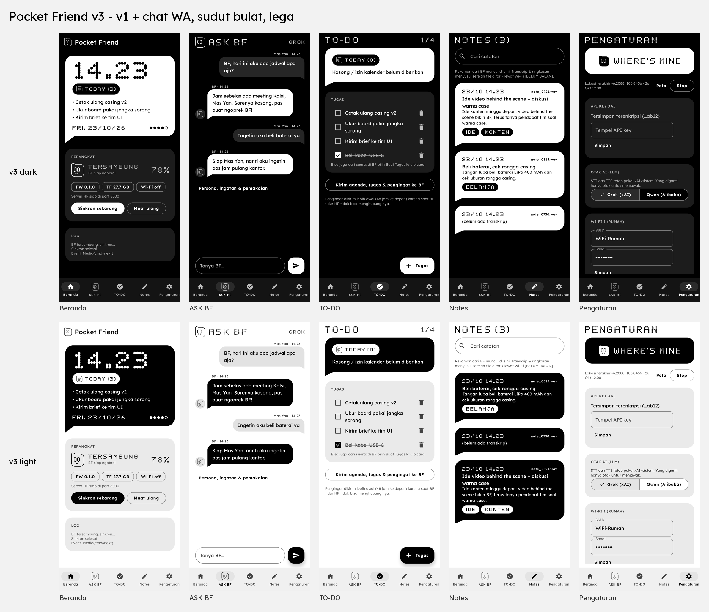

# Pocket Friend

Pocket Friend is an Android companion app for **BF-01 (BestFren)**, a small AI companion device built on an ESP32-S3 board with a 1.54" e-paper screen. The app connects to BF-01 over Bluetooth and Wi-Fi and gives it a brain and a memory.



## What it does

- **Ask AI** – chat with your AI companion by text or voice (Grok/xAI or Qwen, your own API key).
- **To-do and reminders** – tasks and reminders sync to the BF-01 screen.
- **Notes** – voice notes recorded on BF-01 are pulled to the phone, transcribed and summarized.
- **Device settings** – clock, calendar, quiet hours, battery, "Where's mine" (find device / find phone).

No ads, no analytics, no telemetry. API keys are stored encrypted on your phone (Android Keystore).

## Install the APK

1. Download the latest `PocketFriend-*.apk` from [Releases](https://github.com/yanuarm00/pocket-friend/releases).
2. Open the file on your Android phone (Android 8.0 or newer) and allow "install from unknown sources" when asked.
3. If Google Play Protect warns you, tap *More details → Install anyway* (the app is not on the Play Store).
4. Open the app, allow Bluetooth, location, calendar and notifications, then follow the pairing steps for BF-01.
5. Enter your AI provider API key in Settings.

Without a BF-01 device the app still opens, but most features need the device.

## Build from source

Requires JDK 17+ and the Android SDK (platform 36). Kotlin + Jetpack Compose, minSdk 26.

```bash
echo "sdk.dir=$HOME/android-sdk" > local.properties
./gradlew assembleDebug testDebugUnitTest
```

The debug APK ends up in `app/build/outputs/apk/debug/`.

Signed release builds read the keystore from environment variables (`PF_KEYSTORE`, `PF_KEYSTORE_PASSWORD`, `PF_KEY_ALIAS`, `PF_KEY_PASSWORD`). No keystore or password is included in this repo.

## Privacy

Data only leaves your phone when you use a feature: conversation text/audio goes to the AI provider you choose; everything else (calendar, notes, tasks, location) stays on the phone and the BF-01 device. The Wi-Fi link to BF-01 uses plain local-network traffic, so use it on a trusted network.

## Status

Hobby project, early stage. Expect rough edges.
