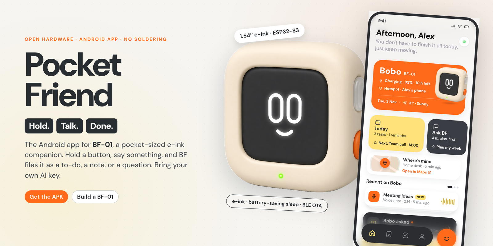
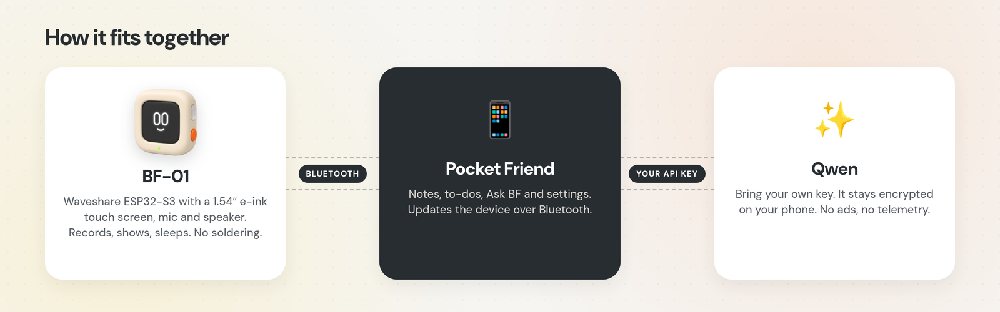
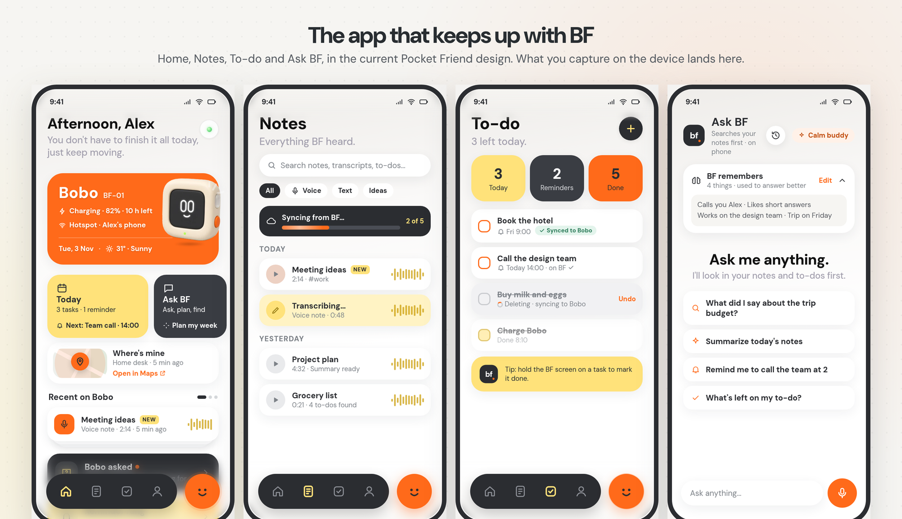
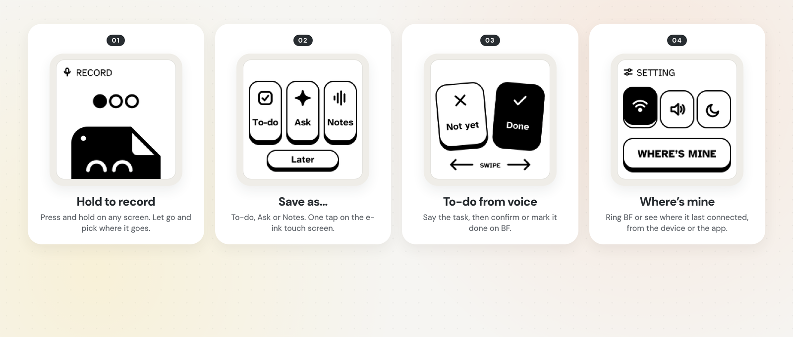
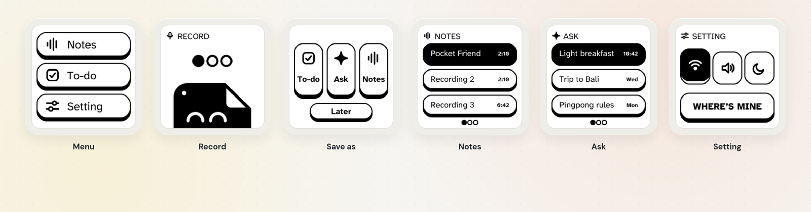

<p align="center">
  
</p>

<p align="center">
  <a href="https://github.com/yanuarm00/pocket-friend/releases/latest"></a>
  
  
  
</p>

<p align="center">
  <a href="https://github.com/yanuarm00/pocket-friend/releases/latest/download/PocketFriend.apk"><b>Get the APK</b></a> ·
  <a href="#build-your-own-bf-01">Build a BF-01</a> ·
  <a href="#roadmap">Roadmap</a> ·
  <a href="#join-in">Join in</a>
</p>

---

## What is BF-01?

BF-01 is a small e-ink companion that fits in your hand. It has a face, a 1.54″ touch screen, a microphone and two buttons. There is no feed to scroll, and the screen only draws when something changes.

You press and hold, you say something, and BF-01 files it: a to-do, a note, or a question for your AI. Pocket Friend is the Android app that goes with it. It keeps your notes, tasks and chats, and it updates BF-01 over Bluetooth.

It started as a hobby project: what if an AI companion was calm, pocket-sized and a bit cute? You can build one from off-the-shelf parts — no soldering.

<p align="center">
  
</p>

## Highlights

| | |
|---|---|
| **Hold to record, anywhere** | Press and hold the button on any screen. Let go and choose *To-do*, *Ask* or *Notes*. |
| **Ask BF** | Ask a question on the device or in the app. The conversation is kept in the app, and answers can show on the e-ink screen. Bring your own Qwen key. |
| **To-do from voice** | Say the task. BF can ask you to confirm it, and the list syncs with the app. |
| **Say Hi QR profiles** | Keep QR profiles (Instagram, for example) in the app and show one on BF so others can scan it. |
| **Where's mine?** | Ring BF-01, or see where it was last connected, from the app or the device. |
| **Character, theme and profile** | Name the device, pick a face and choose a colour theme. Onboarding walks you through the first setup. |
| **Search and privacy** | Search notes and chats. Export or clear data, and choose whether to keep audio. No ads or telemetry. |
| **E-ink and battery saving** | The screen only draws when something changes. BF-01 can sleep with quiet hours and wake when you touch it. |
| **BLE firmware updates** | The app downloads the firmware, checks its SHA-256 against an official list and sends it over Bluetooth. If the new firmware fails to boot, BF-01 rolls back by itself. |

## The app

<p align="center">
  
</p>

Home shows the device, today's tasks and recent recordings. Notes, To-do and Ask BF follow what happens on BF-01. Voice notes you record on the device show up in Notes when the phone connects.

The current app release is Pocket Friend 0.4.11. If you already have it installed, you can update from inside the app.

## A look at the BF-01 screen

A new black-on-white device UI is in testing. The screens below are that design, rendered 1-bit at the real 200×200 panel size and enlarged so the pixels stay sharp. The firmware currently in [Releases](https://github.com/yanuarm00/pocket-friend/releases) is 0.4.1.

<p align="center">
  
</p>

<p align="center">
  
</p>

## Build your own BF-01

No soldering, no custom PCB. Everything you need is off the shelf:

| Part | Notes |
|---|---|
| **Waveshare ESP32-S3-Touch-ePaper-1.54 V2** | 1.54″ e-ink touch screen (200×200, 1-bit), ESP32-S3, 8 MB flash, 8 MB PSRAM, mic + audio codec, RTC, TF card slot. |
| **400 mAh LiPo battery** | Plugs into the board's battery connector. |
| **USB-C cable** | For power and the first flash. |
| **Case (optional)** | 3D-printable case files are on the [roadmap](#roadmap). |
| **microSD card (optional)** | Stores voice notes. Notes sync to the app when you connect. |

Ready-to-flash firmware binaries are in [Releases](https://github.com/yanuarm00/pocket-friend/releases). A step-by-step build guide with flashing instructions is coming soon. Until then, open an issue and we will help you get going.

## Quick start

1. **Install the app.** Download [`PocketFriend.apk`](https://github.com/yanuarm00/pocket-friend/releases/latest/download/PocketFriend.apk) from [Releases](https://github.com/yanuarm00/pocket-friend/releases) and open it on your Android phone (8.0 or newer). Allow *install from unknown sources* when asked. If Google Play Protect warns you, tap *More details → Install anyway*, because the app is not on the Play Store.
2. **Pair BF-01.** Open the app, allow the permissions it asks for, then follow the onboarding or pairing steps.
3. **Add your AI key.** Go to *Settings → AI & voice* and paste your Qwen key. It is stored encrypted in the Android Keystore.
4. **Update the firmware.** Go to *Settings → Software update*. The app downloads the build, verifies it and sends it to BF-01 over Bluetooth.
5. **Hold the button and say something.**

If you already have a signed build installed, open the app and use the in-app updater. It reads the latest GitHub release.

> Without a BF-01 the app still opens, but most features need the device.

## Build the app from source

Requires JDK 17+ and the Android SDK (platform 36). Kotlin + Jetpack Compose, minSdk 26.

```bash
echo "sdk.dir=$HOME/android-sdk" > local.properties
./gradlew assembleDebug testDebugUnitTest
```

The debug APK ends up in `app/build/outputs/apk/debug/`. Signed release builds read the keystore from environment variables (`PF_KEYSTORE`, `PF_KEYSTORE_PASSWORD`, `PF_KEY_ALIAS`, `PF_KEY_PASSWORD`). No keystore or password is included in this repo.

## Privacy

- No ads, no analytics, no telemetry.
- Your API key is stored encrypted in the Android Keystore.
- Conversation text and audio go to the AI provider *you* choose, with *your* key. Calendar, notes, tasks and location stay on your phone and BF-01.
- The Wi-Fi link to BF-01 uses plain local-network traffic, so use it on a network you trust.

## Roadmap

- [x] Hold-to-record on every screen
- [x] Ask BF (Qwen)
- [x] To-do from voice with on-device confirm
- [x] Say Hi QR profiles
- [x] BLE firmware updates with SHA-256 check and rollback
- [x] Onboarding, Profile, Character, Theme, Search and Privacy
- [x] Where's mine
- [ ] Step-by-step build guide
- [ ] Printable case files
- [ ] More faces and expressions for BF-01
- [ ] Your idea here: [open an issue](https://github.com/yanuarm00/pocket-friend/issues/new)

## Join in

This is a hobby project and there is plenty to play with. You don't need to write code to help:

- **Build one** and tell us what broke. Photos of your BF-01 are very welcome.
- **Design a case** or a charging dock. Share the files.
- **Draw a face.** BF-01 can use more character expressions.
- **Translate** the app into your language.
- **Fix a bug or add a feature** with a pull request. Small PRs are best.

Not sure where to start? Open an [issue](https://github.com/yanuarm00/pocket-friend/issues) and say hi.

## License

Pocket Friend is released under the [MIT License](LICENSE).

The BF-01 firmware source is not public yet, but you don't have to build it to try BF-01: ready-to-flash firmware binaries are available in [Releases](https://github.com/yanuarm00/pocket-friend/releases), and the app can update BF-01 over Bluetooth.

---

<p align="center"><sub>Made with a soldering iron left in the drawer.</sub></p>
